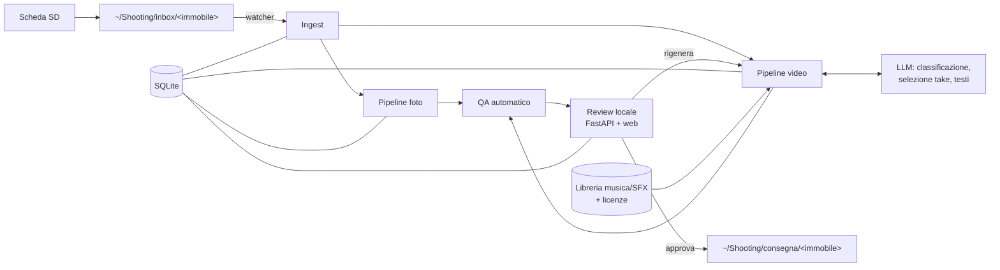

# Handover — Specifica v1

Stato: proposta · 25 novembre 2026 (rev. 7: esiti dello spike video, `docs/spike-01.md`: turbo senza prompt, glossario solo in correzione, VAD, regole delle take)

> **Handover**: la consegna delle chiavi, qui la consegna del lavoro. Repo: `handover`.

## 1. Obiettivo

Dopo uno shooting per l'agente immobiliare, Stefano scarica la scheda sul Mac e trova, senza lavoro manuale:

- le **foto HDR** finite, ottenute dai RAW in bracketing;
- il **reel 9:16 pronto da consegnare**, montato dalle clip: parlato dell'agente pulito dalle take sbagliate, b-roll degli ambienti, sottotitoli, musica, SFX.

L'unico intervento umano è una **review** di pochi minuti: approva oppure rigenera, e conferma numeri e nomi propri nei sottotitoli.

### Ambito

| Dentro | Fuori (v1) |
| --- | --- |
| RAW in bracketing → JPEG HDR | Scatti singoli, foto da smartphone |
| Clip girate in verticale (file 4K orizzontale con tag di rotazione) | Reframing da orizzontale a verticale |
| Reel 9:16 con parlato dell'agente | Formati 16:9, 4:5, video senza parlato |
| Musica e SFX da libreria locale con licenza | Libreria CapCut, musica generata |
| Clip generate con Artlist: home staging virtuale e b-roll di contesto (M5, §6.7) | Generazione di caratteristiche reali dell'immobile, foto AI per i portali |
| Esecuzione locale sul Mac | Cloud, multiutente, accesso per l'agente |
| Reel pubblicati su Instagram, Facebook e TikTok | YouTube, LinkedIn: possibili, ma la licenza di ogni traccia va verificata (§6.4) |

### Hardware di riferimento

- **Macchina**: Nikon Z50II con Viltrox AF 9mm f/2.8 Z. **Decisione: NEF lossless.** Gli shooting fino al 18 novembre sono in High Efficiency (circa 15 MB, non decodificabili da LibRaw 0.22.2: verificato); da ora la macchina va impostata in lossless. Bracketing reale: 5 scatti a passo 1 EV, ordine 0, −2, −1, +1, +2, circa 0,6 s tra uno scatto e l'altro, su treppiede (spostamento misurato < 0,1 px), tipicamente f/8 ISO 1000.
- **Video**: HEVC 8 bit (Main) 3840×2160 a 25 fps, profilo standard, audio PCM 24 bit 48 kHz. Le clip verticali hanno il tag di rotazione (display matrix 90°) e con la rotazione automatica di ffmpeg risultano già dritte. Clip brevi (4–30 s), circa 25–30 per shooting.
- **Elaborazione**: MacBook Pro M1, 16 GB. Tempi e modelli sono dimensionati su questo (§6.2, §12).

## 2. Decisioni di design

| Tema | Scelta | Alternativa scartata | Motivo |
| --- | --- | --- | --- |
| Dove gira | Locale sul Mac | Cloud | 20–50 GB per shooting; interni di case abitate restano in locale |
| Fusione HDR | Exposure fusion (Mertens) + recupero finestre dallo scatto più scuro | Radianza HDR + tone mapping | Resa naturale, pochi parametri; il tone mapping tende al look "HDR finto" |
| Trascrizione | Whisper large-v3-turbo locale (MLX), timestamp per parola, senza prompt | API di trascrizione cloud; large-v3 | Gratis, privata, qualità buona sull'italiano. Nello spike large-v3 è pari in qualità ma usa 4,0 GB contro 2,5 GB |
| Regia | Template fisso + LLM per classificare e scegliere | LLM che decide tutta la regia | Risultato prevedibile e ripetibile |
| Contratto centrale | Piano di montaggio in JSON (§6) | Render diretto | Testabile, rigenerabile, ispezionabile in review |
| Render | Remotion (React) | ffmpeg/MoviePy | Sottotitoli animati e brand per template senza dolore |
| Persistenza | SQLite + filesystem | PostgreSQL | Un solo utente, un solo processo; zero manutenzione |
| Musica e SFX | Libreria locale da Pixabay (licenza unica, valida su tutte le piattaforme) | Meta Sound Collection, librerie commerciali di TikTok, CapCut, Artlist | Gratuita, commerciale, senza attribuzione, file scaricabili. Le librerie di Meta e TikTok valgono ciascuna solo sulla propria piattaforma; CapCut non copre Instagram; Artlist senza licenza per clienti |
| Decodifica RAW | NEF lossless + rawpy. Adobe DNG Converter solo come fallback per gli HE dell'archivio | NEF HE + conversione DNG sempre | Pipeline più semplice, una dipendenza in meno; costo: file più grandi |
| Sorgenti video per il render | Mezzanine ruotati 1440×2560 via VideoToolbox | Render diretto dagli originali | Rotazione e decodifica HEVC 4K risolte una volta; render più veloce su M1 |

## 3. Architettura



- **Watcher** (launchd + watchdog): considera completa una cartella quando la sua dimensione è stabile da 60 s; in alternativa `handover run <cartella>` da riga di comando.
- **Worker**: processi Python, uno per pipeline; le due pipeline girano in parallelo.
- **Uscite verso l'esterno**: solo trascrizione e keyframe a 512 px verso l'LLM. Nessun file originale lascia il Mac.

Stack: Python 3.12, rawpy (LibRaw ≥ 0.22), Adobe DNG Converter (solo per l'archivio HE), OpenCV, lensfunpy, mlx-whisper, ffmpeg con VideoToolbox, Remotion (Node), FastAPI, SQLite.

## 4. Ingest

1. Scansione della cartella: RAW (estensione e magic number), video, altro (ignorato e segnalato).
2. Lettura dell'EXIF: timestamp, bias di esposizione, obiettivo, focale, corpo macchina.
3. **Raggruppamento dei bracket**: scatti consecutivi con intervallo ≤ 2 s e bias di esposizione diversi formano un gruppo. Gruppo valido se contiene 3 o 5 scatti con EV distinti (i valori della Z50II; nelle reference sempre 5).
4. **Controllo del formato RAW**: decodifica di prova con rawpy (`unpack`). Se fallisce, il file è un NEF High Efficiency: flag "imposta la macchina in lossless" e, se Adobe DNG Converter è installato, conversione DNG (§5). Nota: `imread` riesce anche sugli HE, l'errore arriva solo in `unpack`.
5. **Video**: lettura di durata, risoluzione, fps, codec, profondità colore e tag di rotazione.
6. Creazione dello `Shooting` e dei job.

## 5. Pipeline foto

Per ogni gruppo di bracket:

1. **Sviluppo RAW** con rawpy: bilanciamento del bianco della macchina, uscita lineare a 16 bit. Per i NEF HE dell'archivio serve prima la conversione con Adobe DNG Converter da riga di comando (gratuito, supporta la Z50II), salvando DNG non compressi o lossless JPEG: **non** JPEG XL, che LibRaw senza DNG SDK non legge (i DNG HDR di Lightroom nelle reference usano proprio JPEG XL). Costa circa 1–2 s per file.
2. **Allineamento** degli scatti sullo scatto centrale (ECC su immagini ridotte, poi omografia a piena risoluzione). Se l'errore residuo supera la soglia, flag `ghosting_rischio`.
3. **Fusione** Mertens.
4. **Finestre**: maschera delle zone clippate nello scatto centrale, sfumata, e fusione dallo scatto più scuro per rendere leggibile l'esterno.
5. **Colore**: bilanciamento del bianco dalle superfici neutre (pareti e soffitto, i pixel più luminosi a bassa saturazione) con limite di correzione; saturazione massima sui toni caldi (legno, cotto).
6. **Geometria**: il Viltrox 9 mm probabilmente non ha un profilo lensfun. Il profilo di distorsione si calibra una volta (scacchiera o linee rette in 5–10 scatti) e si salva in `ProfiloCamera`. Poi raddrizzamento delle verticali con correzione piena se il ritaglio è ≤ 12%, altrimenti parziale fino a quel limite. Riferimento: il tuo export Lightroom ritaglia circa il 3% (5420×3613 da 5568×3712).
7. **Look di riferimento** (misurato sull'export Lightroom di 11.14): luminosità media L* ≈ 50, nero al 2° percentile ≈ 7, bianchi al 98° ≈ 88, dominante neutra (a*, b* ≈ 0). La fusione Mertens grezza esce a L* ≈ 39: serve un'alzata di esposizione e ombre, con pareti neutre. Questi valori diventano il preset `venezia`.
8. **Coerenza del set**: dopo tutte le foto, allineamento di temperatura colore ed esposizione media sulla mediana dello shooting.
9. **Export**: JPEG sRGB, due profili configurabili (`piena` qualità 92, `portale` lato lungo 2048 px). GPS rimosso. Nome file come oggi: `<primo scatto>-HDR.jpg` in `RAW/EXPORT/`.

Gli scatti singoli fuori da un gruppo vengono sviluppati con lo stesso look, senza fusione, e marcati `singolo`.

## 6. Pipeline video

### 6.1 Preparazione

- **Rotazione**: le clip della Z50II hanno il tag di rotazione (display matrix 90°, cioè 90° in senso antiorario) e la rotazione automatica di ffmpeg le rende già verticali: verificato sulle reference. Regola: si applica il tag. Solo se il tag manca e il file è orizzontale si usa `rotazione_ingresso: -90` del profilo camera (`transpose=2`). Attenzione: alcuni strumenti ignorano il tag, per questo nel tuo editor le clip arrivano orizzontali. Gli originali non vengono mai modificati.
- **Mezzanine**: per ogni clip, un file di lavoro già ruotato a 1440×2560 (dal 2160×3840 di origine), H.264 8 bit ad alto bitrate, codificato con VideoToolbox (hardware dell'M1). Remotion, l'analisi e i keyframe lavorano solo sui mezzanine, così decodifica HEVC e rotazione si fanno una volta sola. Se arriva una clip in N-Log o HLG (non prevista), viene segnalata e non usata. I mezzanine si cancellano alla consegna.
- **Verifica della rotazione**: rilevamento volti su 3 keyframe delle clip con parlato. Se i volti risultano dritti solo con un'altra rotazione, flag `rotazione_sospetta` e uso della rotazione rilevata.
- **Classificazione A/B**: voice activity detection su ogni clip (Silero VAD). Con almeno 1,5 s di parlato è **A-roll**; altrimenti è **b-roll** e Whisper non la trascrive. Nelle A-roll le parole di Whisper che non toccano il parlato rilevato (margine 0,25 s) vengono scartate: sul silenzio Whisper inventa testo ("Grazie.", "Grazie a tutti.": verificato nello spike). Nelle reference l'A-roll è un *walk-and-talk*: l'agente cammina nell'immobile e parla, quindi l'ambiente si vede già nell'A-roll. Per questo l'etichetta ambiente si calcola anche sulle clip A-roll.
- **Take**: nelle reference ogni clip è breve (4–30 s) e contiene di solito una battuta. Le take ripetute sono quindi spesso **file diversi**: il rilevamento delle ripetizioni (§6.2) lavora sull'insieme delle clip, non dentro una sola.
- **Etichetta ambiente** (3 keyframe all'LLM): `esterno | ingresso | soggiorno | cucina | camera | bagno | balcone | dettaglio | altro`, più punteggio di qualità (mosso, esposizione) e l'intervallo utile.

### 6.2 Trascrizione e selezione delle take

1. Whisper sull'audio di tutte le clip A-roll, con timestamp per parola. Modello `large-v3-turbo` su MLX (scelto nello spike: stessa qualità di `large-v3` sull'audio reale, meno memoria). **Nessun `initial_prompt`**: nello spike il glossario come prompt faceva scrivere a Whisper il testo del prompt al posto del parlato vero, e raddoppiava gli errori sulle clip.
2. Segmentazione in frasi.
3. **Rilevamento delle ripetizioni**: frasi con testo normalizzato simile (similarità ≥ 0,7; per le frasi fino a 6 parole anche sui caratteri) entro una finestra temporale sono take della stessa battuta. In più, dallo spike:
   - le frasi lunghe dette d'un fiato, spesso senza punteggiatura, si spezzano dove ci si allineano le frasi delle altre take (almeno due frasi, oppure una pausa ≥ 0,3 s);
   - take improvvisate con lo stesso attacco (prime 8 parole, ≤ 2 errori) sono la stessa battuta;
   - una take interrotta si aggancia alla battuta con cui condivide l'inizio, ma senza fare da ponte tra due battute diverse;
   - l'ordine delle take è il numero progressivo del file: il `creation_time` dei MOV non segue l'ordine di ripresa.
4. **Scelta della take** (LLM, con trascrizione e metadati): preferenza per una **take continua che copre più battute di fila** (meno tagli), poi per la take completa, senza esitazioni né frasi interrotte; a parità, l'ultima. È il criterio osservato nei montaggi di Stefano: a Bernareggio l'apertura viene tutta da una sola take, che non è l'ultima, e cantina, prezzo e chiusura da un'altra unica take. La regola "ultima take completa" da sola indovina 6 casi su 9. Uscita con confidenza; sotto 0,7 → flag in review. Verifica: la mappa audio reel → clip sui reel dell'archivio dice quali take sono state scelte davvero.
5. **Pulizia**: rimozione di filler ("ehm", "allora" a inizio frase se isolato), silenzi > 300 ms accorciati a 150 ms.
6. **Normalizzazione dei numeri**: "centoventi metri quadri" → "120 m²", "duecentocinquantamila euro" → "250.000 €".

### 6.3 Montaggio

Template fisso, ricavato dalle reference:

1. **Aggancio** (0–5 s): battuta d'apertura, spesso un mini-dialogo ("Sei un agente immobiliare?" / "Sì, posso esserti utile"). La domanda può essere di una seconda voce fuori campo: la trascrizione deve gestire più parlanti e i sottotitoli li mostrano entrambi.
2. **Corpo**: parlato selezionato. Quando l'agente nomina un ambiente, il b-roll di quell'ambiente copre la frase (match su parole chiave + LLM). Ogni jump cut interno a una clip A-roll è coperto da un b-roll; se non ce ne sono abbastanza, alternanza di zoom al 100%/110% sull'A-roll.
3. **Regole**: massimo circa 4 s di agente fisso nel corpo; nessun b-roll ripetuto; b-roll di durata 1,5–3,5 s.
4. **Chiusura**: call to action dell'agente in camera ("Contattami, io sono Simone Venezia…"), più card finale opzionale (logo `IMMOBILIARE VENEZIA.jpg`, telefono).

Durata obiettivo 45–80 s (reference: 53 s e 76 s); oltre 90 s di parlato selezionato → flag. B-roll: pochi inserti di dettaglio (porta, termostato, cucina, bagno) e ambienti vuoti; l'agente resta in scena per la maggior parte del reel.

### 6.4 Audio

- Voce: passa-alto a 80 Hz, denoise leggero (RNNoise), compressione leggera, loudness integrata −14 LUFS, true peak ≤ −1 dBTP. Nota: i reel attuali sono a −21,4 e −22,7 LUFS, cioè circa 7–8 dB più bassi di quanto si usa sui social. È un cambiamento voluto rispetto a oggi, configurabile.
- **Fonte**: Pixabay, sia musica sia SFX. Licenza gratuita, uso commerciale ammesso, attribuzione non richiesta, nessun limite di piattaforma. Ogni traccia entra in libreria con `handover lib add` insieme alla prova della licenza: URL della pagina, autore, data di download e copia dei termini Pixabay in vigore quel giorno.
- **Filtro per piattaforma**: ogni traccia ha `piattaforme_consentite`. Il render chiede le piattaforme di destinazione (default `instagram, tiktok`) e sceglie solo tracce che le coprono tutte. Così si possono aggiungere altre fonti (per esempio Meta Sound Collection, valida solo per Facebook e Instagram) senza rischiare di usarle su TikTok.
- **Content ID**: alcune tracce Pixabay sono registrate da chi le ha caricate su sistemi di riconoscimento e possono generare reclami. Mitigazione: libreria piccola e curata, tracce con reclami escluse in modo permanente (`Traccia.bloccata`).
- **Consegna**: il file `LEGGIMI.txt` ricorda all'agente che, se pubblica su TikTok con un account Business, al caricamento deve confermare di avere i diritti sulla musica (Music Usage Confirmation) e non deve aggiungere musica dall'app.
- Musica: traccia dalla libreria scelta per mood (default `elegante | moderno | caldo`) e durata. Ducking in sidechain sotto la voce (circa −20 dB rispetto alla voce), fade-in 0,5 s, fade-out 1,5 s sulla chiusura.
- SFX: whoosh all'ingresso dei b-roll, al massimo uno ogni 2 s, −12 dB rispetto alla voce.
- Il tempo lo detta il parlato; i tagli dei b-roll si spostano di ±150 ms per cadere sul beat più vicino quando possibile.

### 6.5 Sottotitoli

- **Stile attuale da replicare**: oggi è un template interno di CapCut, quindi font e colori non si possono esportare. Valori misurati sui fotogrammi del reel 11.14:
  - **Font**: Montserrat Black (licenza OFL, uso commerciale libero), confermato da Stefano. È il più vicino al template tra quelli provati, per larghezza e peso delle lettere; Poppins Black risulta più stretto. Non si usa il font del template perché la sua licenza fuori da CapCut non è nota.
  - Testo MAIUSCOLO bianco, contorno nero di circa 5 px a 1440 px di larghezza, altezza delle maiuscole circa 75–80 px.
  - **Parola pronunciata** (karaoke) dentro un riquadro **#003864** con angoli arrotondati (raggio circa 8 px).
  - 1–2 righe, 3–6 parole per gruppo, centrate; area del testo tra y 1838 e 2097, cioè 72–82% dell'altezza.
  - Parole chiave a volte in una card a parte tra virgolette ("VILLA").
- Numeri come cifre: "€188.000", "3 LOCALI", "30M".
- Safe zone 1440×2560: baseline tra il 70% e l'80% dell'altezza, margine destro ≥ 210 px (pulsanti di Instagram e TikTok), mai sotto i 2050 px. Va verificato che la posizione attuale (~75%) non finisca sotto la didascalia di TikTok.
- **Glossario per agente**: nome dell'agente, agenzia, comuni ricorrenti e vie corrette. Cresce con le correzioni fatte in review e si usa **solo nella passata di correzione dopo la trascrizione** (sostituzioni da glossario, per esempio "in merita" → "in vendita" o "WMC" → "VMC"), mai come prompt di Whisper (§6.2.1). Le parole corrette vengono marcate e passano dalla conferma in review come i token critici.
- **Token critici**: numeri, prezzi, metrature, indirizzi e nomi propri vengono marcati e richiedono conferma in review (§8).

### 6.6 Render

Remotion, **1440×2560, 25 fps** (come i reel attuali e il girato), H.264 High, circa 16 Mbit/s, AAC 320 kbit/s. Template di brand per agente: font, colore del riquadro, logo, card finale.

### 6.7 Clip generate con Artlist (M5)

Serve a replicare quello che fai già a mano: nel reel di Lissone ci sono transizioni da stanza vuota a stanza arredata.

**Casi d'uso**

| Caso | Input | Output | Regola |
| --- | --- | --- | --- |
| Home staging virtuale | Fotogramma di un b-roll di una stanza vuota (o una foto HDR) | Clip image-to-video della stessa stanza arredata, con la stessa inquadratura | Sovrimpressione "Arredamento virtuale" obbligatoria per tutta la durata |
| Transizione prima/dopo | Clip reale + clip generata | Dissolvenza o wipe dal reale al generato | Prima sempre il reale |
| B-roll di contesto | Prompt testuale (zona, stagione, luce) | Clip generica di città o lifestyle | Mai spacciata per l'immobile o per una vista reale |

**Vincoli**

- Mai generare caratteristiche reali dell'immobile: vista dalle finestre, terrazzo, giardino, finiture, metrature percepite. Si genera solo arredamento e contesto generico.
- Ogni segmento generato porta `generated: true` nel piano di montaggio e una sovrimpressione che il template non permette di togliere.
- Le foto per i portali non vengono mai generate o modificate con l'AI.

**Integrazione**

- Artlist è raggiungibile via MCP, quindi questo passo gira come sessione Claude Code non interattiva (`claude -p`) con l'MCP di Artlist, invocata dalla pipeline con input e output su file. Il resto della pipeline resta Python puro.
- Flusso: scelta del fotogramma (b-roll con etichetta ambiente e stanza vuota) → upload dell'immagine → stima del costo → generazione → download → segmento `generated` nel piano.
- **Costi**: prima di ogni batch si chiede la stima dei crediti. Si procede senza chiedere conferma, salvo quando la stima arriva ad almeno il 10% dei crediti disponibili: lì serve conferma in review.
- In review le clip generate compaiono in una sezione a parte, accettabili o scartabili una per una. Una clip scartata non blocca il reel.

**Licenza**: per Artlist i contenuti generati sono di chi li genera, anche per uso commerciale e anche dopo la scadenza dell'abbonamento. È diverso dagli asset del catalogo (musica, footage), che il tuo piano non copre per i clienti. Va comunque verificato che il tuo piano includa gli strumenti AI e che i termini non escludano usi specifici.

## 7. Piano di montaggio (contratto JSON)

```json
{
  "version": 1,
  "shooting_id": "2026-11-14-bernareggio",
  "format": { "w": 1440, "h": 2560, "fps": 25 },
  "template": "venezia-v1",
  "segments": [
    {
      "id": "s1",
      "type": "aroll",
      "clip": "Z50_6415.MOV",
      "rotation": 90,
      "in_ms": 3120, "out_ms": 6480,
      "zoom": 1.0,
      "words": [{ "t": "Sei", "start_ms": 3120, "end_ms": 3600, "critical": false }]
    },
    {
      "id": "s2",
      "type": "broll",
      "clip": "Z50_6399.MOV",
      "rotation": 90,
      "in_ms": 800, "out_ms": 3200,
      "room": "cucina",
      "covers": "s1",
      "sfx": "whoosh-03"
    },
    {
      "id": "s3",
      "type": "generated",
      "source_frame": "Z50_6399.MOV@1200ms",
      "file": "gen/s3-soggiorno-arredato.mp4",
      "generated": true,
      "overlay": "Arredamento virtuale",
      "transition_from": "s2"
    }
  ],
  "audio": {
    "music": { "track": "lib/elegante/track-07.wav", "license_id": "L-0007", "gain_db": -20, "duck": true },
    "voice_lufs": -14
  },
  "end_card": true
}
```

Il piano è versionato: ogni rigenerazione crea una nuova versione e non sovrascrive la precedente.

## 8. Review

Pagina locale con tre sezioni:

1. **Foto**: griglia prima/dopo, flag per foto, rigenera singola con override (luminosità, calore, verticali sì/no).
2. **Video**: player del render e trascrizione allineata, con le take scartate visibili e ripristinabili.
3. **Conferme**: elenco dei token critici con il fotogramma. Il pulsante "Consegna" è disabilitato finché non sono tutti confermati o corretti. Ogni correzione aggiorna il glossario e rigenera solo i sottotitoli.

Azioni sul video: approva, rigenera (altra musica, altro b-roll, durata più corta), ripristina una take.

## 9. Modello dati

```text
Agente(id, nome, agenzia, telefono, template, glossario jsonb, created_at)
ProfiloCamera(id, modello, rotazione_ingresso, lens_default,
              raw_compressione_attesa)
Shooting(id, agente_id, cartella, stato, created_at)
Gruppo(id, shooting_id, n_scatti, ev_list, stato)
Foto(id, shooting_id, gruppo_id nullable, file_out, params jsonb, qa_flags, versione)
Clip(id, shooting_id, file, durata_ms, rotazione, tipo[aroll|broll|generated], room, qualita, qa_flags)
Generazione(id, shooting_id, clip_sorgente_id nullable, prompt, modello, crediti_stimati,
            crediti_usati, file_out, stato[stimata|in_corso|pronta|accettata|scartata], created_at)
Trascrizione(id, clip_id, words jsonb, modello)
PianoMontaggio(id, shooting_id, versione, json, created_at)
Render(id, piano_id, file_out, durata_ms, metriche jsonb, approvato bool)
Traccia(id, file, tipo[musica|sfx], mood, bpm, durata_ms, fonte, licenza_id,
        licenza_file, licenza_prova jsonb, piattaforme_consentite text[], bloccata bool)
Job(id, tipo, ref_id, stato, tentativi, errore, created_at)
```

`Traccia.licenza_file` è obbligatorio: senza licenza, la traccia non entra nella libreria.

## 10. Interfacce

| Comando / endpoint | Scopo |
| --- | --- |
| `handover run <cartella> [--agente X]` | Avvia manualmente uno shooting |
| `handover lib add <file> --mood --fonte --url --piattaforme` | Aggiunge una traccia alla libreria con la prova della licenza |
| `GET /shootings/{id}` | Stato, foto, piano, render |
| `POST /photos/{id}/render` | Rigenera una foto con override |
| `POST /shootings/{id}/video/regenerate` | Nuovo piano con vincoli (musica, durata, b-roll) |
| `POST /critical/{id}` | Conferma o correggi un token critico |
| `POST /shootings/{id}/deliver` | Copia in `consegna/` (bloccato se ci sono token aperti) |

## 11. Casi limite

| Caso | Comportamento |
| --- | --- |
| File verticale nativo (larghezza < altezza) | Nessuna rotazione |
| Tag di rotazione assente su file orizzontale | Rotazione dal profilo camera (−90), flag |
| Seconda voce fuori campo nell'aggancio | Sottotitolata come l'agente; non conta come take ripetuta |
| Volti dritti solo con un'altra rotazione | Usa la rotazione rilevata, flag |
| Gruppo di bracket incompleto o ambiguo | Sviluppa gli scatti come singoli, flag |
| Ghosting (persone, tende mosse) | Fusione con lo scatto centrale come riferimento nelle zone in movimento, flag |
| Nessuna clip con parlato | Niente reel; flag "solo b-roll" (fuori ambito v1) |
| Ambiente nominato senza b-roll | Resta sull'A-roll con zoom alternato |
| Due take ugualmente buone | Sceglie l'ultima, flag con l'alternativa ripristinabile |
| Audio del parlato rovinato (vento, clipping) | Flag bloccante |
| Libreria senza tracce del mood richiesto | Usa il mood di default, flag |
| Download interrotto o file corrotti | Il file viene escluso, flag; il resto procede |
| NEF High Efficiency (archivio o macchina non reimpostata) | Flag "imposta lossless"; conversione DNG se Adobe DNG Converter è installato |
| Clip in N-Log o HLG | Esclusa, flag |
| Nessuna traccia che copra tutte le piattaforme richieste | Render bloccato, flag con le piattaforme scoperte |
| Clip a 120p (slow motion) | Usata come b-roll al 25% di velocità; mai come A-roll |

## 12. Criteri di accettazione

Misurati su un set di test di 10 shooting reali.

- Rotazione corretta sul 100% delle clip.
- Nessuna frase ripetuta nel reel finale nel ≥ 95% dei video.
- Sottotitoli: word error rate dopo glossario ≤ 5%; il 100% dei token critici passa dalla conferma.
- Loudness della voce −14 LUFS ± 1 LU; true peak ≤ −1 dBTP.
- Nessun sottotitolo fuori dalla safe zone.
- Foto: verticali con deviazione residua media < 0,5°; nessun ghosting visibile nel ≥ 95% delle foto.
- Tempo dal download alla review pronta: da misurare sul Mac nello spike, obiettivo ≤ 15 minuti per 40 gruppi di bracket + 15 clip.
- Intervento manuale medio in review ≤ 3 minuti per shooting.

## 13. Rischi

| Rischio | Tipo | Mitigazione |
| --- | --- | --- |
| Errori su prezzi e indirizzi nei sottotitoli | Reputazione dell'agente | Token critici con conferma bloccante |
| Musica senza licenza adeguata | Legale | Libreria con file di licenza obbligatorio; niente CapCut |
| Reclami Content ID su tracce Pixabay | Legale, operativo | Libreria curata, tracce bloccate dopo un reclamo, prova della licenza conservata |
| Agente che aggiunge musica in app su TikTok o Instagram | Legale | Istruzioni in `LEGGIMI.txt`; il reel esce già con la musica |
| LibRaw non legge i NEF HE della Z50II (confermato) | Tecnico | Macchina in NEF lossless; archivio via Adobe DNG Converter con DNG non JPEG XL |
| M1 lento su Whisper e render | Tempi | Mezzanine via VideoToolbox; con 16 GB foto e video in parallelo, ma Whisper e render Remotion mai insieme |
| Interni di case e dati dell'agente | Privacy | Esecuzione locale, all'LLM solo keyframe ridotti e testo, GPS rimosso |
| Whisper sbaglia dialetto o rumore | Qualità | Glossario, flag sull'audio, ripristino delle take |
| Selezione delle take errata | Qualità | Confidenza + take scartate visibili in review |
| Il look standard non piace all'agente | Prodotto | Parametri di stile per agente nel template |
| Clip generate scambiate per reali | Legale, reputazione | Sovrimpressione obbligatoria, niente caratteristiche reali generate, niente AI sulle foto dei portali |
| Consumo crediti Artlist | Costi | Stima prima di ogni batch, conferma se ≥ 10% dei crediti disponibili |
| Remotion e Node come seconda runtime | Manutenzione | Isolato dietro un solo comando `render <piano.json>` |

## 14. Piano

| Fase | Contenuto | Durata | Uscita |
| --- | --- | --- | --- |
| Spike | Decodifica di un NEF lossless reale · calibrazione distorsione Viltrox 9 mm · Whisper su 11.14 e 11.18 con confronto rispetto ai sottotitoli dei reel finiti · selezione delle take sulle clip reali · tempi sull'M1 | 1 settimana | Go/no-go su decodifica RAW, trascrizione e selezione |
| M1 — Foto | Ingest, raggruppamento, fusione, finestre, geometria, coerenza, export | 1 settimana | Foto pronte dal primo shooting |
| M2 — Parlato | Trascrizione, take, A-roll, sottotitoli, render base | 2 settimane | Reel con solo A-roll e sottotitoli |
| M3 — B-roll e audio | Etichette ambienti, copertura dei tagli, musica, ducking, SFX | 1 settimana | Reel completo |
| M4 — Review | Pagina di review, token critici, glossario, consegna | 1 settimana | Flusso end-to-end |
| M5 — Clip generate | Sessione Claude Code + MCP Artlist, scelta dei fotogrammi, stima costi, segmenti `generated` con sovrimpressione | 1 settimana | Home staging virtuale nel reel |

## 15. Reference analizzate

- `11.14 - BERNAREGGIO`: 5 NEF in bracketing (Z50_6306–6310), DNG HDR e JPG export di Lightroom, 2 clip, reel finito (53 s, 1440×2560, 25 fps, −21,4 LUFS, 10 tagli netti più movimenti di camera).
- `11.18 - LISSONE`: reel finito (76 s, −22,7 LUFS), con transizioni di home staging virtuale.
- Archivio completo: 15 shooting in `/Volumes/WORK/IMMOBILIARE VENEZIA`, ognuno con `RAW/`, `CLIP/` e reel finito: è il set di test naturale per §12.

## 16. Domande aperte

- Spazio su disco: verificare la dimensione reale dei NEF lossless della Z50II al primo shooting (stima circa 25 MB).
- Se in futuro serve musica più riconoscibile: valutare una licenza per lavori su commissione (Uppbeat, Epidemic Sound, Artlist) e aggiungerla come nuova fonte filtrata per piattaforma.
